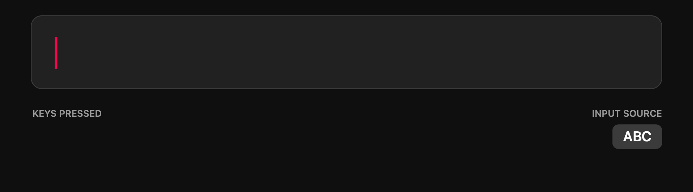

<p align="center">
  
</p>

<h1 align="center">TypingFixer</h1>

<h3 align="center">Type in Hebrew or English. The keyboard layout catches up.</h3>

<p align="center">
  
</p>

<p align="center">
  <a href="https://github.com/ShmuelOps/typingfixer/releases/latest"></a>
</p>

<p align="center"><code>macOS 13+ · Universal · no network</code></p>

<p align="center">
  TypingFixer notices when you're typing in the wrong layout and fixes the word for you,<br>
  so you never have to think about it again.
</p>

---

## How it works

Menu-bar app for macOS 13+. When you finish a word typed in the wrong keyboard
layout (`ביקבל` → `check`, `akuo` → `שלום`), it retypes the word in the right
layout and switches the input source. Hebrew ↔ English (US QWERTY / macOS "Hebrew").

A word is fixed only when what you typed is not a word in its own language and
the converted text is, according to the macOS spell-checker dictionaries.

Written from scratch; no code from any other app.

## Privacy

- **No networking.** `scripts/build.sh` fails the build if the binary links
  Network.framework or CFNetwork, imports any socket/DNS/URL-loading symbol, or
  contains a URL. There is no update check, no telemetry, no crash reporter.
- Keystrokes are held in memory only for the current word. Nothing is logged
  or written to disk.
- Password fields: macOS Secure Input hides keystrokes from the app, and it also
  stops processing while Secure Input is on.

## Install

```sh
brew install --cask shmuelops/tap/typingfixer
```

Or download the DMG from Releases and drag TypingFixer to Applications. The build is
self-signed, not notarized, so macOS blocks the first launch: open it once, then
click **Open Anyway** in System Settings → Privacy & Security
(or run `xattr -dr com.apple.quarantine /Applications/TypingFixer.app`).
Homebrew handles this for you.

Grant **Accessibility** in System Settings → Privacy & Security. The menu-bar
arrows icon shows a `!` until it's granted. Releases are signed with the same
certificate, so the grant carries over to updates (`brew upgrade --cask typingfixer`).
Coming from 0.5.x or earlier (ad-hoc signed)? Re-grant once: remove the old entry first.

## Build

```sh
scripts/build.sh 0.1.0   # → build/TypingFixer.app, build/TypingFixer-0.1.0.dmg
```

Needs the Xcode command-line tools. The script runs `TypingFixer --selftest` and
the no-network check.

## Release

Push a `v*` tag. The `release` workflow builds the DMG and attaches it to a
GitHub release.

```sh
git tag v0.1.0 && git push origin v0.1.0
```
